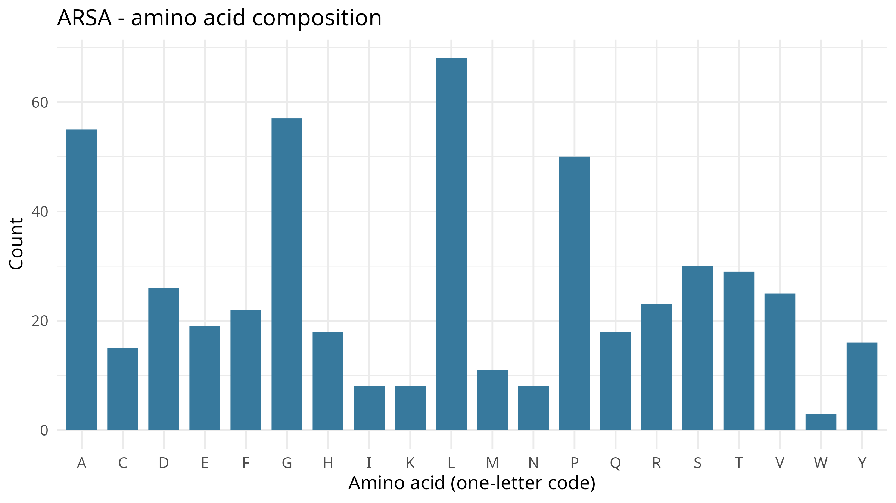
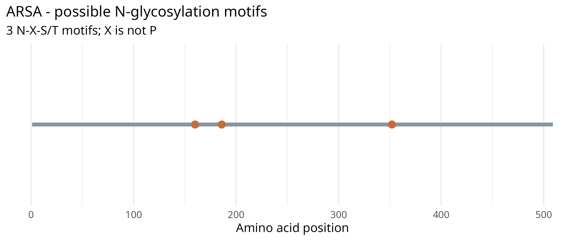

# Lysosomal Enzyme Analysis: ARSA

## Enzyme and Gene Information

- **Enzyme name:** Arylsulfatase A
- **Gene symbol:** *ARSA*
- **Protein accession:** NP_000478.3
- **Protein length:** 509 amino acids
- **NCBI reference:** [ARSA — NCBI Gene and Protein Records](https://www.ncbi.nlm.nih.gov/datasets/gene/410/#transcripts-and-proteins)

## Biological Function

Arylsulfatase A (ARSA) is a lysosomal sulfatase that catalyzes the removal of sulfate groups from sulfatides, particularly cerebroside sulfate, during sphingolipid degradation. This activity is important for normal lipid turnover and the maintenance of myelin in the nervous system.

## Amino Acid Composition

The protein sequence analysis identified leucine (L), glycine (G), alanine (A), proline (P), and serine (S) as the five most abundant amino acids.

| Amino acid | Count | Percentage |
|---|---:|---:|
| Leucine (L) | 68 | 13.36% |
| Glycine (G) | 57 | 11.20% |
| Alanine (A) | 55 | 10.81% |
| Proline (P) | 50 | 9.82% |
| Serine (S) | 30 | 5.89% |

### Figure 1. Amino Acid Composition of ARSA

*Figure 1. Amino acid composition of the ARSA protein, showing the relative abundance of amino acid residues in the analyzed sequence.*

## 4. Potential N-Glycosylation Sites

Sequence analysis identified three potential N-linked glycosylation motifs. These motifs follow the consensus sequence **N-X-S/T**, where X represents any amino acid except proline.

| Position | Motif | Potential glycosylation site |
|---|---|---|
| 160 | NLT | Asparagine at position 160 |
| 186 | NLS | Asparagine at position 186 |
| 352 | NVT | Asparagine at position 352 |

### Figure 2. Potential N-Glycosylation Sites in ARSA

*Figure 2. Predicted N-linked glycosylation motifs identified in the ARSA amino acid sequence. These represent potential sites rather than experimentally confirmed glycosylation.*

## Guide Questions

### 1. What does your enzyme normally break down inside lysosomes?

Arylsulfatase A hydrolyzes sulfatides, particularly cerebroside sulfate, by removing their sulfate groups. This process contributes to lysosomal sphingolipid degradation and normal myelin maintenance.

### 2. What is the total length of your protein, and which amino acids are most common?

The analyzed ARSA protein contains **509 amino acids**. The five most abundant residues are leucine (68; 13.36%), glycine (57; 11.20%), alanine (55; 10.81%), proline (50; 9.82%), and serine (30; 5.89%).

### 3. How many potential N-glycosylation motifs did you find? Where are they located?

Three potential N-glycosylation motifs were identified: NLT at position 160, NLS at position 186, and NVT at position 352. These sequence positions indicate potential glycosylation sites but do not confirm that glycans are attached.

### 4. Why can glycosylation matter for lysosomal proteins? Does finding a motif prove the protein is glycosylated?

Glycosylation can contribute to protein folding, stability, and intracellular trafficking. For lysosomal enzymes, appropriate processing and trafficking are important for delivery to the lysosomal compartment. However, identifying an N-X-S/T motif does not prove that the site is glycosylated because actual glycan attachment depends on factors such as protein folding, cellular processing, and site accessibility. Sequence analysis alone also cannot establish the presence of a mannose-6-phosphate targeting marker.

### 5. What could happen in the cell if your enzyme did not work properly?

Impaired ARSA activity can cause sulfatide accumulation in lysosomes, particularly in cells involved in myelin maintenance. This accumulation disrupts normal myelin function and can lead to metachromatic leukodystrophy, a lysosomal storage disorder characterized by progressive neurological deterioration
